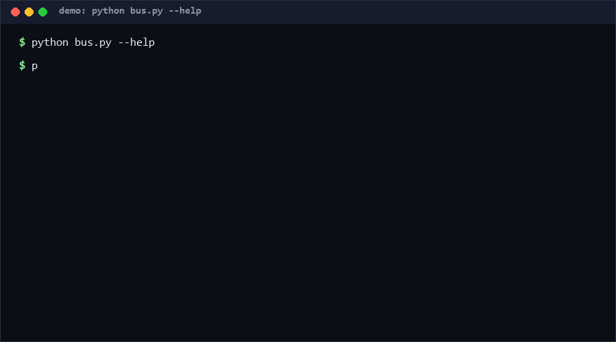

# local-model-cli-bus

A minimal bus specification that lets coding agents launch and switch local inference engines through one command interface. Ships an adapter contract plus two reference stubs. Engine-specific APIs stay behind adapters, so agents get a plug-and-switch engine layer instead of hard-coded vendor flags.

Bus spec version: **0.1** · Data currency: **as of 2026-10-11**.

<p align="center"></p>

## Problem

Local inference is no longer "run a model, chat in a REPL" — agent CLIs are the customer, and a real workstation hosts several local engines side by side. But each engine exposes its own launch flags, health semantics and defaults, so every agent integration hard-codes one vendor's interface. Switching engines (or adding a fallback engine for quota/network outages) means editing integration code. The missing piece is not another engine; it is a thin, boring contract *between* agents and engines.

## How it works

**The contract (spec v0.1)** — an adapter implements exactly two methods:

| Method | Signature | Meaning |
|---|---|---|
| `build_launch_command` | `(spec, model, opts) -> argv` | the exact command line to start the engine serving `model` |
| `healthcheck_fields` | `(spec) -> [field, ...]` | which fields an agent may probe for readiness |

**The registry** — engines are described by data, not code:

```json
{"version": "0.1",
 "engines": {"my-engine": {"adapter": "openai-compat",
                            "command": ["local-engine", "serve"],
                            "base_url": "http://127.0.0.1:11434/v1"}}}
```

**Shipped adapters** (reference stubs, not vendor bindings):

- `echo` — dry-run stub; emits the plan for tests and pipeline previews.
- `openai-compat` — targets *any* OpenAI-compatible local HTTP server using only generic flags (`--model`, `--base-url`). No vendor-private API is referenced.

The CLI defaults to dry-run: `launch` prints the plan; `--exec` actually runs it.

## Quickstart (~2 min)

```bash
# Step 1: list engines (~1 s)
python bus.py engines

# Step 2: build a launch plan, dry-run by default (~1 s)
python bus.py launch stub-local-openai --model glm-local --context 8192

# Step 3: use your own registry (~1 s)
python bus.py --registry my-engines.json launch my-engine --model m7

# Full self test (~15 s; dry-run only, starts no processes)
python self_test.py
```

## Why not X

| Alternative | Why not |
|---|---|
| Hard-code one engine's CLI in every agent | Works until you add a second engine or the vendor renames flags; switching becomes a code change instead of a config change. |
| Full orchestration framework (containers, supervisors) | Correct for datacenters, overkill for one workstation; agents need one command and a readiness field, not a control plane. |
| Vendor SDKs per engine | Each SDK is another dependency and another API to trust; adapters keep engine specifics in a JSON registry you can diff and review. |
| OpenAI-compatible HTTP proxy in front of everything | Solves *serving* uniformity but not *launching*: something still has to start, configure and health-check the engine process. |

## Minimal Fallback

No Python on the target box? The spec is two method signatures and a JSON schema — implementable in an afternoon in any language. The built-in stub registry prints valid plans with zero configuration: `python bus.py launch stub-echo --model anything`.

## Design Trade-offs

Priority: **no vendor lock-in > dry-run safety > simplicity > feature count**. Adapters speak generic flags only, so engine-specific tuning lives in the registry (data, reviewable, diffable) rather than adapter code. Dry-run is the default because a bus that can surprise-launch processes is a liability in agent hands. We deliberately do not model conversation routing — that belongs to the agent, not the bus.

## Limits & Second-order Effects

- Spec v0.1 covers launch + readiness probing only: no streaming, no tool-calling mediation, no multi-model GPU scheduling.
- The `openai-compat` adapter assumes the engine's CLI *accepts* generic flags; engines that need exotic flags need a dedicated adapter (that is the point of the contract).
- **Second-order effects**: if such a bus becomes standard, registry files become a new attack/griefing surface (a poisoned registry can point an agent at a hostile "engine"); and universal dry-run defaults may train agents to never verify that the launched engine actually answers — always run the health probe after `--exec`.

## FAQ

**When NOT to use this bus?** Single-engine, single-agent setups where you already call the engine's library directly (the bus only adds indirection). Production fleet serving (use a real orchestrator). Also: if your agent cannot execute local commands at all, there is nothing for the bus to drive.

**Does this bind to a specific local engine's private API?** No. The shipped adapters use generic flags and registry data only; vendor specifics stay in *your* registry file.

**Is `launch` dangerous?** By default it prints a plan and touches nothing. `--exec` runs the argv, and `self_test.py` never passes `--exec` against anything but the echo stub.

**How does this compare to engines' own "launch for agent" features?** Those couple you to one engine. The bus is the neutral layer that makes them interchangeable from the agent's side.

**How do I write a new adapter?** Subclass `Adapter`, implement the two contract methods, and register with `@register("your-name")`. Keep engine-specific flags in your registry entry — if your adapter hard-codes them, you have rebuilt the lock-in this spec exists to remove.

Confidence: **High (>=80%)** that the adapter contract is implementable as specified (two working adapters, fully unit-tested). **Medium (60–79%)** that two generic flags suffice for most local engines — based on the dominance of OpenAI-compatible local servers, not on an exhaustive engine survey `[estimated]`.

## [Core Assumptions]

1. OpenAI-compatible HTTP serving is the de-facto interchange format for local engines, so generic `--model`/`--base-url` flags cover most cases.
2. Agent CLIs can execute a local command and poll a readiness signal; without that, no bus can help.
3. Engine-specific configuration is stable enough to live in a static registry file rather than dynamic discovery.
4. Dry-run-first semantics are required for any tool agents are allowed to call unsupervised.

## License

MIT — see [LICENSE](LICENSE). Copyright (c) 2026 zhengming contributors.
